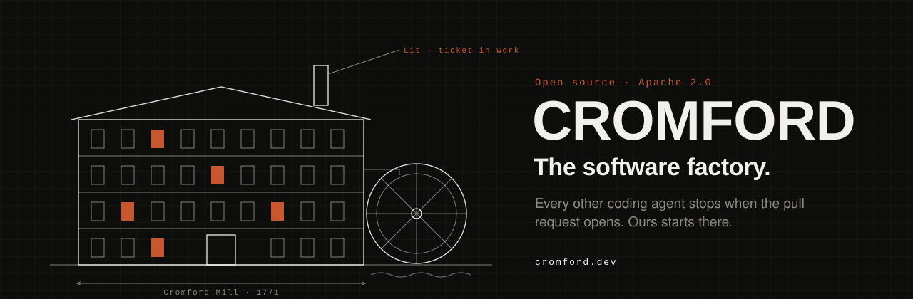
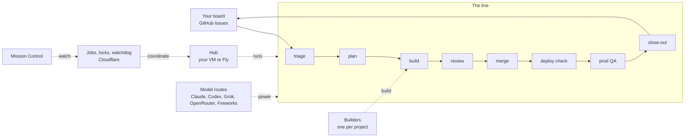

<p align="center">
  <a href="https://cromford.dev"></a>
</p>

<p align="center">
  <a href="https://cromford.dev/quickstart/"><strong>Quickstart</strong></a> ·
  <a href="https://cromford.dev">Docs</a> ·
  <a href="https://github.com/cromford-ai/cromford/discussions">Discussions</a> ·
  <a href="CONTRIBUTING.md">Contributing</a> ·
  <a href="LICENSE">Apache 2.0</a>
</p>

# Cromford

**The software factory.** Every other coding agent stops when the pull request opens. Ours starts there.

File a ticket on your board. Cromford plans it, builds it, reviews it, merges it, checks the deploy and tests it in production. Then it comments on your ticket with what shipped, direct links, and what it cost.

It runs on your own accounts: your GitHub, your Cloudflare, your machines and your model keys. Nothing is hosted for you unless you want it to be.

<p align="center"></p>

## Where other agents stop

A coding agent that opens a pull request has done the easy part. Someone still has to review it, merge it, ship it, check it in production and tell the person who asked. That is most of the job.

| | A typical coding agent | Cromford |
|---|---|---|
| Reads the ticket thread and asks when something is unclear | | ✓ |
| Writes acceptance tests before the code | | ✓ |
| Writes the code and opens a PR | ✓ | ✓ |
| Has a separate reviewer that can block the merge | | ✓ |
| Merges through a queue, holds risky changes for a person | | ✓ |
| Confirms production is running the merged commit | | ✓ |
| Signs in as a user and checks the new behavior | | ✓ |
| Reports back on the ticket with links and the cost | | ✓ |

## Quickstart

You need a GitHub account, a Cloudflare account, a Fly account or a VM, and a model key.

```bash
# 1. Fork, clone and configure
gh repo fork cromford-ai/cromford --clone
cd cromford && cp env-templates/selfhost.conf.example selfhost.conf

# 2. See every resource your install needs, before anything is created
bin/selfhost-install.sh --config selfhost.conf --dry-run

# 3. Add a repo and file a ticket
bin/load-project.sh acme/invoices --project invoices --box <your-hub>
gh issue create -R acme/invoices --label ai-build --title "Export the invoices list as CSV"
```

Triage picks up the issue, and your first pull request follows. Cromford only ever acts on issues labeled `ai-build`.

The full guide, including creating the resources from your dry-run plan, is at **[cromford.dev/quickstart](https://cromford.dev/quickstart/)**.

## What's in the box

- **A bill on every change.** Every model call is priced and rolled up to the pull request it served.
- **Hard spending caps.** A ceiling per call and per lane per day, on by default. The line stops at the cap and tells you.
- **Review that can say no.** A separate session reads the diff against the ticket. Approval is tied to the exact commit it read.
- **A merge queue with judgment.** Routine changes merge on their own. Schema, auth, billing and very large diffs wait for a person.
- **Checked in production.** After the deploy, Cromford signs in like a user and confirms the change is really there.
- **Mistakes become checks.** Review findings that keep coming back turn into rules that fail in CI.
- **Archie, the operator.** Watches the goals you set and messages you only when something needs you.
- **Mission Control.** A web console for the whole fleet: what's building, what needs you, and what it all cost.

## Any model

Use Claude, Codex, Grok, OpenRouter or Fireworks. Every stage of the line has its own model route, stored as data: pick a primary for each stage and line up the others as fallbacks. Put your strongest model on review and a cheaper one on triage, then change your mind without a deploy.

## Talk to it from your AI tool

Cromford ships an MCP server, so you can run the factory from Claude Code, Claude Desktop, Cursor, VS Code, Windsurf or any other tool that speaks the Model Context Protocol. Ask "what is the fleet doing?", "why is this PR stuck?" or "hand this plan to the factory", and your assistant answers from your own Mission Control.

```json
{
  "mcpServers": {
    "cromford": {
      "command": "node",
      "args": ["/path/to/cromford/mcp/server.mjs"],
      "env": { "HARNESS_CONSOLE_URL": "https://<your-console>.workers.dev" }
    }
  }
}
```

- **Read tools:** fleet and project status, builds, pipeline, PRs, alerts, costs, machines, logs, and a chat line to the orchestrator.
- **Action tools:** file a ticket, comment, hold, run triage, pause or resume a board, fetch build artifacts.
- **Guarded actions:** merging a PR and turning automerge on need an explicit `confirm: true`, and only reach repos on your allowlist.
- Your console secret stays on your machine. It never appears in a tool result or a log.

Setup and the full tool list: [cromford.dev](https://cromford.dev).

## How it fits together



More detail in [docs/ARCHITECTURE.md](docs/ARCHITECTURE.md).

## We build Cromford with Cromford

Most changes to Cromford are planned, built, reviewed and merged by Cromford. When the factory gets something wrong, it shows up in our own work first, and the fix becomes a check that keeps it from happening again.

## Make it better

Cromford works with the accounts above. A few optional services make it faster and calmer, such as a merge queue, hosted CI runners and chat alerts. See [Optional services](https://cromford.dev) on the docs site for what each adds and how to switch it on.

## Community

- Questions and ideas: [Discussions](https://github.com/cromford-ai/cromford/discussions)
- Bugs and feature requests: [Issues](https://github.com/cromford-ai/cromford/issues)
- Contributing: [CONTRIBUTING.md](CONTRIBUTING.md)
- Security reports: [SECURITY.md](SECURITY.md)

Want us to run it for you? **Cromford Cloud** is coming.

## License

Apache 2.0. See [LICENSE](LICENSE) and [NOTICE](NOTICE).

Cromford™ is a trademark of its owner. The license covers the code, not the name. Forks are welcome to say they are based on Cromford, but not to call themselves Cromford.

<sub>Named for Cromford Mill in Derbyshire, England. Richard Arkwright's mill turned a craft into a line in 1771. This one runs on tokens.</sub>
